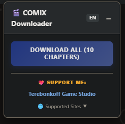
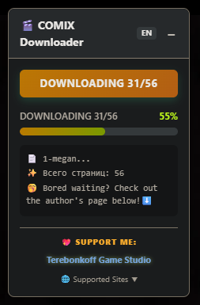

# 📚 COMIX ZIP Downloader & Live Stats by TGS

> **Next-generation all-in-one suite for browsing, tracking, and downloading adult comics, manga, and hentai.**  
> Batch download entire multi-chapter series or single chapters directly into clean ZIP archives at lightning speed, view real-time card stats directly in catalogs, auto-track viewed titles, and curate your personal Favorites with a stunning golden border!

---

## ⚡ 1-Click Fast Install

| Action | Direct Link |
|---|---|
| **🚀 Install in Violentmonkey / Tampermonkey** | [**👉 Click Here to Install (v3.403)**](https://raw.githubusercontent.com/Terebonkoff/TGS-UserScripts/main/COMIX_ZIP_Downloader_by_TGS.user.js) |
| **💖 Support Terebonkoff Game Studio on Patreon** | [**Patreon Creator Page**](https://www.patreon.com/c/terebonkoff/about?utm_source=userscript_comix&utm_medium=tgs_suite) |
| **⭐ Official GitHub Repository** | [**Terebonkoff/TGS-UserScripts**](https://github.com/Terebonkoff/TGS-UserScripts) |

---

## 🔥 Key Features

1. **📊 Live Card Stats in Catalogs (Zero Clicking Needed):**
   - Directly on listing pages, genre filters, and search results (before opening any gallery), an elegant overlay displays live statistics:
     - 📄 **Page Count** — exact number of pages in the manga/chapter;
     - 📥 **Download Count** — popularity among other users;
     - ❤️ **Favorites / Likes** — total user bookmarks and upvotes;
     - ★ **Rating** — community score out of 5;
     - 👁 **Views** — total visitor impressions.
2. **✅ Smart Viewed History (`VIEWED` + Neon-Green Outline):**
   - Automatically tracks every comic you open or view. Previously explored titles are highlighted with a prominent neon-green outline and a `✔ VIEWED` badge. Never lose track of what you've already read!
3. **⭐ Personal Favorites System (`FAVORITE` + Glowing Gold Frame):**
   - Every card features a sleek white star button in the top-right corner.
   - Clicking the star instantly toggles **TGS Favorite** status: the card gets an eye-catching glowing gold frame, the badge switches to `★ FAVORITE`, and the star fills with radiant gold!
   - Clicking the star does not navigate away, allowing you to curate your reading list seamlessly.
4. **📦 Batch Download All Chapters in 1 Click (Multi-Volume Series):**
   - On webtoon, manhwa, and serialized comic pages, a prominent **DOWNLOAD ALL (X CHAPTERS)** button packages all chapters into a neatly organized ZIP archive with proper chronological folder naming.
5. **⚡ Blazing Fast Single-Chapter ZIP Downloader:**
   - Multi-threaded asynchronous image fetching with automatic CDN limit bypass, retry handlers, and a live percentage progress bar.
6. **🌐 Interactive 38+ Site Navigator:**
   - Built-in popup dropdown providing instant 1-click access to the top 38 comic archives on the web.

---

## 📸 Screenshots & Showcase

### 1. Live Card Statistics (Pages, Rating, Views)
Instant preview of comic length, community ratings, and view counts before clicking into any title:

---

### 2. Auto-Tracked Reading History (`✔ VIEWED` Badge)
Titles you have already opened are highlighted with a neon-green border, a `✔ VIEWED` badge, and full card metrics:

---

### 3. Manga Archive Integration & Engagement Counters
Accurate page counts, favorite tallies, and visited tags across the largest manga platforms:

---

### 4. Manhwa & Webtoon Card Analytics
Full page counts, reader bookmarks, and 5-star ratings displayed seamlessly on modern manhwa layouts:

---

### 5. 1-Click Full Series Batch Downloader
Download all chapters of any serialized comic with a single click into a single organized ZIP:

---

### 6. Real-Time Download Progress Bar
Lightning-fast parallel image packaging with live percentage, page numbers, and remaining file counter:

---

### 7. Instant Multi-Site Navigation Menu
Switch between the best 38 adult comic archives instantly with the integrated dropdown navigator:

---

## 🌐 Full List of Supported Sites (38 Archives)

The suite is optimized, powered by custom parsers, and continuously tested across 38 major platforms:

### 🌟 Premier Manga & Hentai Archives:
- `nhentai.net` — Live card stats, VIEWED badge, Favorites, high-speed ZIP export;
- `imhentai.xxx` — Page counts, downloads, favorite tallies, single-click ZIPs;
- `hentaiera.com` — Live favorite and download stats with native page counter integration;
- `e-hentai.org` / `exhentai.org` — Full-resolution master image extraction;
- `18comic.vip` / `18comic.org` / `18kami.com` — Anti-scramble image reconstruction & chapter downloads;
- `allporncomic.com` / `allporncomics.co` — Manhwa reader support, ratings, bookmarks, full batch downloader;
- `8muses.com` / `8muses.io` — Multi-album extraction;
- `multporn.net` — Batch gallery archiver.

### 📚 Popular Comic Portals & CG Art Repositories:
- `ilikecomix.com` — PhotoSwipe gallery integration & live card statistics;
- `xlecx.one` / `xlecx.com` — Ad-bypass and clean ZIP downloads;
- `bestporncomix.com` — Card analytics and high-speed downloads;
- `porncomix.info` — Full archive downloader;
- `freeadultcomix.com` — Clean chapter downloader;
- `xcartx.com` — High-speed parallel image packaging;
- `xyzcomics.com` — Instant ZIP packaging;
- `kingcomix.com` — Multi-page comic series;
- `onlycomix.net` — Clean extraction.

### ⚡ Author Studios, 3D Artists & Themed Libraries:
- `toon34.com` — 3D and animated comic series;
- `palcomix.com` — Classic parody comic archives;
- `savitahd.net` — High-definition serialized chapter archiver;
- `comixhere.xyz` — Full issue download support;
- `sexkomix22.com` / `sexkomix6.com` — Multi-part series downloader;
- `svscomics.com` — Clean issue packaging;
- `gedecomix.com` — Full gallery integration;
- `oglaf.com` — Webcomic archiver;
- `thehentai.net` — Card metrics and ZIP exports;
- `erofus.com` / `erovers-comics.com` — Themed comic portals;
- `hentaixcomic.com` / `hentaixdickgirl.com` / `hentaixyuri.com` — Niche comic archives;
- `nxt-comics.com` — Latest webcomic releases.

---

## ⚙️ Installation & Automatic Updates

All scripts include official `@downloadURL` and `@updateURL` metadata tags.  
Once installed, your userscript manager (**Violentmonkey** or **Tampermonkey**) will automatically check for and install updates directly from this repository.

1. Install [Violentmonkey](https://violentmonkey.github.io/) (recommended) or [Tampermonkey](https://www.tampermonkey.net/).
2. Open the [**Direct Script Installation Link (v3.403)**](https://raw.githubusercontent.com/Terebonkoff/TGS-UserScripts/main/COMIX_ZIP_Downloader_by_TGS.user.js).
3. Click **Confirm installation** in the browser tab.
