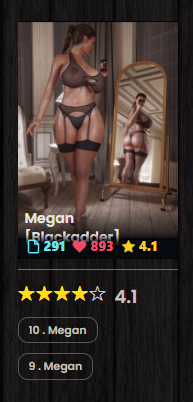

# 📚 COMIX ZIP Downloader & Live Stats by TGS

> **Мощный автономный комплекс для фанатов комиксов, манги и хентая.**  
> Позволяет скачивать целые тайтлы или отдельные главы в ZIP-архивах на максимальной скорости, отображает живую статистику карточек прямо в каталогах и подсвечивает уже просмотренное!

---

## ⚡ Быстрая установка

| Действие | Ссылка |
|---|---|
| **🚀 Установить в Violentmonkey / Tampermonkey** | [**👉 Кликните здесь для установки (v3.402)**](https://raw.githubusercontent.com/Terebonkoff/TGS-UserScripts/main/COMIX_ZIP_Downloader_by_TGS.user.js) |
| **💖 Поддержать Terebonkoff Game Studio** | [**Patreon Studio**](https://www.patreon.com/c/terebonkoff/about?utm_source=userscript_comix&utm_medium=tgs_suite) |
| **⭐ Исходный код репозитория** | [**Terebonkoff/TGS-UserScripts**](https://github.com/Terebonkoff/TGS-UserScripts) |

---

## 🔥 Ключевые возможности

1. **📊 Живая статистика карточек (Live Card Stats):**
   - Прямо в общей ленте и поиске без перехода внутрь показывает:
     - 📄 **Количество страниц** в манге / главе;
     - 📥 **Количество скачиваний** другими пользователями;
     - ❤️ **Количество добавлений в избранное** (лайки);
     - ★ **Средний рейтинг** читателей;
     - 👁 **Количество просмотров**.
2. **✅ Умная метка просмотренного (`VIEWED` + зелёная рамка):**
   - Запоминает всё, что вы открывали, и подсвечивает карточки яркой неоново-зелёной рамкой с плашкой `✔ VIEWED`. Больше никаких случайных повторных открытий!
3. **📦 Пакетное скачивание всех глав разом (Download All Chapters):**
   - Одной кнопкой упаковывает все главы многотомного комикса в упорядоченный ZIP-архив с сохранением правильной нумерации файлов.
4. **⚡ Скоростное скачивание отдельной главы в ZIP:**
   - Высокоскоростная параллельная загрузка изображений со встроенным обходом лимитов хостинга и прогресс-баром в реальном времени.
5. **🌐 Быстрый навигатор по топовым сайтам:**
   - Встроенное всплывающее меню переходов между лучшими поддерживаемыми архивами комиксов в один клик.

---

## 📸 Галерея и демонстрация работы

### 1. Живая статистика на iLikeComix
Отображение количества страниц (📄 70), пользовательского рейтинга (★ 5) и общего числа просмотров (👁 8.9K) прямо на карточке:

---

### 2. Живая статистика и статус просмотренного на imHentai
Отображение зелёного бейджа `✔ VIEWED`, количества страниц (📄 66), загрузок (⬇ 1441) и сердечек избранного (❤ 469):

---

### 3. Живая статистика и статус просмотренного на nHentai
Чёткое отображение количества страниц (📄 91) и избранного (❤ 26207) с визуальным выделением просмотренных галерей:

---

### 4. Живая статистика на AllPornComic
Отображение страниц (📄 291), закладок читателей (❤ 893) и звёздного рейтинга (★ 4.1):

---

### 5. Панель управления и кнопка скачивания всех глав разом
Кнопка **DOWNLOAD ALL (10 CHAPTERS)** для автоматического выкачивания всего многотомника целиком в один клик:

---

### 6. Процесс скачивания главы с живым индикатором прогресса
Молниеносный прогресс-бар с отображением текущей страницы, общего числа файлов и процента готовности:

---

### 7. Каталог поддерживаемых сайтов
Всплывающее меню с быстрыми ссылками для перехода на крупнейшие поддерживаемые библиотеки комиксов:

---

## 🌐 Список поддерживаемых сайтов

Скрипт оптимизирован и непрерывно тестируется на следующих ресурсах:

- 🟢 `nhentai.net` — живые карточки, статус VIEWED, скачивание в ZIP;
- 🟢 `imhentai.xxx` — карточки со страницами, скачиваниями и избранным;
- 🟢 `hentaiera.com` — точные счётчики избранного и загрузок (с сохранением нативного счётчика страниц);
- 🟢 `allporncomic.com` — поддержка манхва-ридеров, рейтинги, лайки, пакетное скачивание глав;
- 🟢 `ilikecomix.com` — полная интеграция PhotoSwipe-галерей и статистики;
- 🟢 `18comic.vip` / `18comic.org` — обход шифрования и выкачивание глав;
- 🟢 `e-hentai.org` / `exhentai.org` — быстрый сбор полноразмерных оригиналов;
- 🟢 `8muses.com` — пакетная загрузка альбомов.

---

## ⚙️ Установка и автообновление

Скрипт содержит официальные мета-теги `@downloadURL` и `@updateURL`.  
После разовой установки браузерное расширение (**Violentmonkey** или **Tampermonkey**) будет автоматически проверять наличие свежих версий прямо из этого репозитория.

1. Установите [Violentmonkey](https://violentmonkey.github.io/) (рекомендуется) или Tampermonkey.
2. Откройте [**прямую ссылку на скрипт**](https://raw.githubusercontent.com/Terebonkoff/TGS-UserScripts/main/COMIX_ZIP_Downloader_by_TGS.user.js).
3. В открывшемся окне подтвердите установку.
