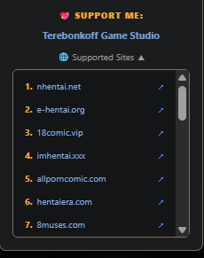

# 📚 COMIX ZIP Downloader & Live Stats by TGS

> **Next-generation all-in-one suite for browsing, tracking, and downloading adult comics, manga, and manhwa.**  
> Automatically fetches live metrics on card covers across 38+ websites, highlights your reading history, allows 1-click personal Favoriting with custom golden glow frames, and packages entire multi-volume series into clean ZIP archives at maximum bandwidth.

---

## ⚡ 1-Click Fast Install

| Action | Direct Link |
|---|---|
| **🚀 Install in Violentmonkey / Tampermonkey** | [**👉 Click Here to Install (v3.403)**](https://raw.githubusercontent.com/Terebonkoff/TGS-UserScripts/main/COMIX_ZIP_Downloader_by_TGS.user.js) |
| **☕ Support via Boosty (Card / PayPal)** | [**Boosty Creator Page**](https://boosty.to/terebonkoff?utm_source=userscript_comix&utm_medium=tgs_suite) |
| **💖 Support via Patreon (Game Studio)** | [**Patreon Creator Page**](https://www.patreon.com/c/terebonkoff/about?utm_source=userscript_comix&utm_medium=tgs_suite) |
| **⭐ Official GitHub Repository** | [**Terebonkoff/TGS-UserScripts**](https://github.com/Terebonkoff/TGS-UserScripts) |

---

## 📸 Visual Showcase & Core Capabilities

### 1. 📊 Live Dynamic Card Metrics (Adapts to Each Archive)
Instead of forcing you to click into every title to check its details, the script automatically parses whatever data is available on that specific site and cleanly displays it in a subtle overlay at the bottom of the card:
- 📄 **Page Count** — exact number of pages inside;
- 📥 **Downloads** — total community downloads;
- ❤️ **Favorites / Bookmarks** — reader upvotes and likes;
- ★ **Rating** — community score out of 5;
- 👁 **Views** — total visitor impressions.

*Each website has its own feature set — if a platform supports ratings or downloads, the script surfaces them dynamically right over the cover:*

| **iLikeComix** (Pages • Rating • Views) | **imHentai** (Pages • Downloads • Likes) |
|:---:|:---:|
|  |  |
| **nHentai** (Pages • Favorites) | **AllPornComic** (Pages • Bookmarks • Rating) |
|  |  |

---

### 2. 🏷️ Smart Reading History (`VIEWED`) & Personal Favorites (`FAVORITE`)
- **Auto-Tracked History:** Any comic you open or view is automatically remembered. Its card receives a crisp neon-green border and a top-left **`✔ VIEWED`** tag, so you never accidentally read the same story twice.
- **1-Click Personal Favorites:** Every card features a white star button in the top-right corner. Clicking the star toggles **TGS Favorite** status:
  - The border instantly shifts to a **glowing royal gold frame** (`#eab308`);
  - The badge transforms into a radiant **`★ FAVORITE`** gold label;
  - The star fills with vibrant gold.
  - *Clicking the star does not open the link, making catalog curation effortless!*

---

### 3. 📦 Instant High-Speed ZIP Downloader (Single & Multi-Volume)
- **1-Click Batch Downloader:** Serialized manga and webtoons feature a dedicated **DOWNLOAD ALL (X CHAPTERS)** button to download and package all volumes into a single structured ZIP archive.
- **Fast Single-Chapter Archiver:** Multi-threaded image fetching bypasses server-side speed throttles and displays an active progress percentage with live page counts.

| **Batch Multi-Chapter Downloader** | **Active Real-Time Progress Bar** |
|:---:|:---:|
|  |  |

---

### 4. 🌐 Quick-Jump Navigator (38+ Supported Sites)
A sleek expandable popup allows instant jumping between the internet's largest and highest-quality comic archives with zero bookmarks clutter:

  

---

## 🌐 Complete Directory of Supported Sites (38 Archives)

### 🌟 Premier Manga & Hentai Archives:
- `nhentai.net` — Live card stats, VIEWED badge, Favorites, clean ZIP export;
- `imhentai.xxx` — Page counts, downloads, favorite tallies, instant ZIPs;
- `hentaiera.com` — Live favorite and download stats with native page counter integration;
- `e-hentai.org` / `exhentai.org` — Full-resolution master image extraction;
- `18comic.vip` / `18comic.org` / `18kami.com` — Anti-scramble image reconstruction & chapter downloads;
- `allporncomic.com` / `allporncomics.co` — Manhwa reader support, ratings, bookmarks, full batch downloader;
- `8muses.com` / `8muses.io` — Multi-album extraction;
- `multporn.net` — Batch gallery archiver.

### 📚 Popular Comic Portals & CG Art Repositories:
- `ilikecomix.com` — PhotoSwipe gallery integration & live card statistics;
- `xlecx.one` / `xlecx.com` — Ad-bypass and clean ZIP downloads;
- `bestporncomix.com` — Card analytics and high-speed downloads;
- `porncomix.info` — Full archive downloader;
- `freeadultcomix.com` — Clean chapter downloader;
- `xcartx.com` — High-speed parallel image packaging;
- `xyzcomics.com` — Instant ZIP packaging;
- `kingcomix.com` — Multi-page comic series;
- `onlycomix.net` — Clean extraction.

### ⚡ Author Studios, 3D Artists & Themed Libraries:
- `toon34.com` — 3D and animated comic series;
- `palcomix.com` — Classic parody comic archives;
- `savitahd.net` — High-definition serialized chapter archiver;
- `comixhere.xyz` — Full issue download support;
- `sexkomix22.com` / `sexkomix6.com` — Multi-part series downloader;
- `svscomics.com` — Clean issue packaging;
- `gedecomix.com` — Full gallery integration;
- `oglaf.com` — Webcomic archiver;
- `thehentai.net` — Card metrics and ZIP exports;
- `erofus.com` / `erovers-comics.com` — Themed comic portals;
- `hentaixcomic.com` / `hentaixdickgirl.com` / `hentaixyuri.com` — Niche comic archives;
- `nxt-comics.com` — Latest webcomic releases.

---

## ⚙️ Installation & Automatic Updates

All scripts include official `@downloadURL` and `@updateURL` metadata tags.  
Once installed, your userscript manager (**Violentmonkey** or **Tampermonkey**) will automatically check for and install updates directly from this repository.

1. Install [Violentmonkey](https://violentmonkey.github.io/) (strongly recommended) or [Tampermonkey](https://www.tampermonkey.net/).
2. Open the [**Direct Script Installation Link (v3.403)**](https://raw.githubusercontent.com/Terebonkoff/TGS-UserScripts/main/COMIX_ZIP_Downloader_by_TGS.user.js).
3. Click **Confirm installation** in the browser tab.

---

## 💖 Support the Studio & Future Updates

If you find this suite useful and want to support ongoing updates, new site integrations, and 18+ game projects by **Terebonkoff Game Studio**:

  
  &nbsp;&nbsp;&nbsp;&nbsp;
  

| Method | Description & Perks | Direct Link |
|---|---|---|
| **☕ Boosty** | Support via Bank Cards (RU & Worldwide), PayPal, Crypto & One-time Donates | [**👉 Support via Boosty**](https://boosty.to/terebonkoff?utm_source=userscript_comix&utm_medium=tgs_suite) |
| **💖 Patreon** | Monthly tiers, exclusive 18+ game development devlogs & private adult art packs | [**👉 Support via Patreon**](https://www.patreon.com/c/terebonkoff/about?utm_source=userscript_comix&utm_medium=tgs_suite) |

> 💬 *Additional international donation methods are currently being set up. Thank you for helping keep all TGS suites 100% free, ad-free, and actively updated!*
