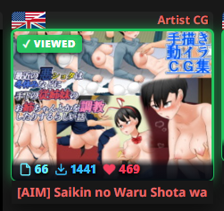

# 📚 COMIX ZIP Downloader & Live Stats by TGS

> **Автономный комплекс нового поколения для чтения и скачивания взрослой манги, комиксов и хентая.**  
> Позволяет скачивать целые многотомники или отдельные главы в упорядоченных ZIP-архивах на максимальной скорости, отображает живую статистику прямо в каталогах, автоматически отмечает просмотренные тайтлы и позволяет вести собственное Избранное с эффектной золотой рамкой!

---

## ⚡ Быстрая установка

| Действие | Ссылка |
|---|---|
| **🚀 Установить в Violentmonkey / Tampermonkey** | [**👉 Кликните здесь для установки (v3.403)**](https://raw.githubusercontent.com/Terebonkoff/TGS-UserScripts/main/COMIX_ZIP_Downloader_by_TGS.user.js) |
| **💖 Поддержать Terebonkoff Game Studio** | [**Patreon Studio**](https://www.patreon.com/c/terebonkoff/about?utm_source=userscript_comix&utm_medium=tgs_suite) |
| **⭐ Исходный код репозитория** | [**Terebonkoff/TGS-UserScripts**](https://github.com/Terebonkoff/TGS-UserScripts) |

---

## 🔥 Что умеет скрипт (Ключевые возможности)

1. **📊 Живая статистика карточек (Live Card Stats):**
   - Прямо в общей ленте, жанрах и поиске (до перехода на страницу комикса) выводит аккуратную плашку с реальными данными:
     - 📄 **Количество страниц** в манге или выпуске;
     - 📥 **Количество скачиваний** другими пользователями;
     - ❤️ **Количество добавлений в избранное** (лайки / сердечки читателей);
     - ★ **Средний пользовательский рейтинг**;
     - 👁 **Общее количество просмотров**.
2. **✅ Умная отметка просмотренного (`VIEWED` + зелёная подсветка):**
   - Скрипт запоминает всё, что вы когда-либо открывали. Просмотренные тайтлы выделяются яркой неоново-зелёной рамкой и аккуратной плашкой `✔ VIEWED`. Больше не нужно гадать, читали вы этот комикс или нет!
3. **⭐ Личное Избранное (`FAVORITE` + золотая рамка):**
   - В правом верхнем углу каждой обложки расположена аккуратная белая звёздочка.
   - Один клик по звёздочке — и карточка мгновенно переходит в **Избранное TGS**: рамка окрашивается в роскошный золотистый цвет, зажигается золотой бейдж `★ FAVORITE`, а звёздочка наполняется золотым свечением. Клик по звёздочке не открывает комикс, позволяя быстро сортировать ленту.
4. **📦 Пакетное скачивание всех глав разом (Download All Chapters):**
   - На страницах многотомных веб-комиксов и манхвы появляется кнопка **DOWNLOAD ALL (X CHAPTERS)**, которая в один клик выкачивает все главы целиком и бережно раскладывает их по упорядоченным папкам внутри одного ZIP-архива.
5. **⚡ Молниеносное скачивание одной главы в ZIP:**
   - Высокоскоростной асинхронный сбор оригиналов изображений в максимальном разрешении в обход ограничений хостингов с живым прогресс-баром в реальном времени.
6. **🌐 Встроенный навигатор по 38+ сайтам:**
   - Быстрое всплывающее меню переходов между лучшими онлайн-библиотеками комиксов интернета.

---

## 📸 Галерея и демонстрация работы

### 1. Живая статистика карточек (страницы, рейтинг, просмотры)
Прямо в ленте каталога выводятся точные данные о количестве страниц, пользовательских оценках и популярности:

---

### 2. Отметка просмотренного (статус VIEWED и зелёная рамка)
Тайтлы, которые вы уже изучали, выделяются зелёной рамкой с бейджем `✔ VIEWED` и подробной статистикой (страницы, загрузки, избранное):

---

### 3. Индикация популярности и просмотренного в каталогах
Поддержка крупнейших хентай-агрегаторов с живым обновлением счётчиков фаворитов и страниц:

---

### 4. Комплексная аналитика для манхвы и веб-комиксов
Отображение страниц, закладок и рейтингов на современных манхва-порталах:

---

### 5. Пакетная загрузка всех глав целиком
Одной кнопкой **DOWNLOAD ALL** весь многотомник скачивается в единый упорядоченный ZIP-архив:

---

### 6. Скоростная загрузка главы с живым индикатором
Наглядный прогресс скачивания с отображением текущей страницы, общего объёма и процента готовности:

---

### 7. Быстрое меню переходов по сайтам
Удобный выпадающий список для мгновенного перехода в любую поддерживаемую библиотеку:

---

## 🌐 Полный список поддерживаемых сайтов (38 ресурсов)

Скрипт оптимизирован, оснащён специальными парсерами и непрерывно тестируется на огромном числе ресурсов:

### 🌟 Крупнейшие мировые архивы манги и хентая:
- `nhentai.net` — живые карточки, статус VIEWED, Избранное, скачивание в ZIP;
- `imhentai.xxx` — карточки со страницами, скачиваниями и избранным;
- `hentaiera.com` — точные счётчики избранного и загрузок (с сохранением нативного счётчика страниц);
- `e-hentai.org` / `exhentai.org` — оригиналы в максимальном разрешении;
- `18comic.vip` / `18comic.org` / `18kami.com` — обход шифрования и выкачивание глав;
- `allporncomic.com` / `allporncomics.co` — поддержка манхва-ридеров, рейтинги, лайки, пакетное скачивание глав;
- `8muses.com` / `8muses.io` — пакетная загрузка альбомов;
- `multporn.net` — пакетное сохранение галерей.

### 📚 Популярные порталы комиксов и CG-артов:
- `ilikecomix.com` — интеграция PhotoSwipe-галерей и статистики;
- `xlecx.one` / `xlecx.com` — обход рекламы и скачивание комиксов;
- `bestporncomix.com` — карточки и скачивание выпусков;
- `porncomix.info` — полная поддержка архивов;
- `freeadultcomix.com` — быстрое сохранение глав;
- `xcartx.com` — пакетная выгрузка картинок;
- `xyzcomics.com` — сохранение в ZIP;
- `kingcomix.com` — поддержка многостраничных выпусков;
- `onlycomix.net` — выкачивание комиксов.

### ⚡ Авторские студии, 3D и тематические порталы:
- `toon34.com` — поддержка 3D и мультипликационных комиксов;
- `palcomix.com` — архивы классических пародий;
- `savitahd.net` — загрузка высококачественных глав;
- `comixhere.xyz` — скачивание выпусков;
- `sexkomix22.com` / `sexkomix6.com` — поддержка серий комиксов;
- `svscomics.com` — сохранение выпусков;
- `gedecomix.com` — полная интеграция галерей;
- `oglaf.com` — сохранение веб-стрипов;
- `thehentai.net` — карточки и загрузка архивов;
- `erofus.com` / `erovers-comics.com` — тематические комикс-библиотеки;
- `hentaixcomic.com` / `hentaixdickgirl.com` / `hentaixyuri.com` — специализированные архивы;
- `nxt-comics.com` — поддержка свежих веб-релизов.

---

## ⚙️ Установка и автообновление

Скрипт содержит официальные мета-теги `@downloadURL` и `@updateURL`.  
После установки браузерное расширение (**Violentmonkey** или **Tampermonkey**) автоматически проверяет наличие свежих версий прямо из этого репозитория.

1. Установите [Violentmonkey](https://violentmonkey.github.io/) (рекомендуется) или Tampermonkey.
2. Откройте [**прямую ссылку на скрипт (v3.403)**](https://raw.githubusercontent.com/Terebonkoff/TGS-UserScripts/main/COMIX_ZIP_Downloader_by_TGS.user.js).
3. В открывшейся вкладке подтвердите установку.
