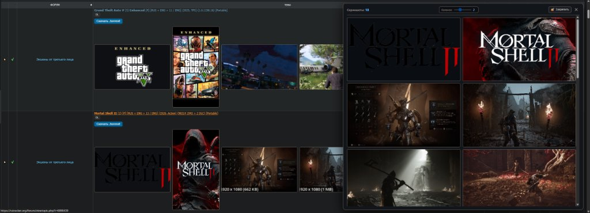
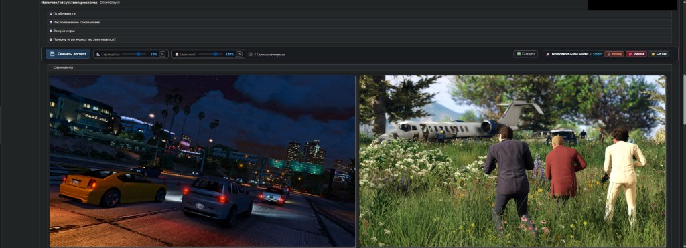

# 🧲 RuTracker: Enhanced Suite by TGS

> **Мощный премиальный комплекс для максимального комфорта на RuTracker.**  
> Вы всегда видите, что за раздача вас ждёт, ещё даже не переходя в неё! Превью-обложка и аккуратная лента скриншотов прямо в строке поиска, мгновенная кнопка скачивания `.torrent` в один клик, боковое выезжающее окно со всей лентой скриншотов при наведении, единый тулбар внутри раздачи и полноэкранный Lightbox без рекламы и сжатия сторонних хостингов.

---

## ⚡ Быстрая установка в 1 клик

| Источник | Прямая ссылка |
|---|---|
| **🚀 Установка с GitHub (версия 5.28)** | [**👉 Нажмите для установки с GitHub**](https://raw.githubusercontent.com/Terebonkoff/TGS-UserScripts/main/RuTracker_Complete_Suite.user.js) |
| **🦊 Зеркало на Greasy Fork** | [**👉 Установить с Greasy Fork**](https://greasyfork.org/ru/scripts/605546-rutracker-enhanced-suite-by-tgs) |
| **☕ Поддержать автора на Boosty (Карты / СБП / PayPal)** | [**Страница Terebonkoff на Boosty**](https://boosty.to/terebonkoff?utm_source=userscript_rutracker&utm_medium=tgs_suite) |
| **💖 Поддержать студию на Patreon** | [**Patreon Creator Page**](https://www.patreon.com/c/terebonkoff/about?utm_source=userscript_rutracker&utm_medium=tgs_suite) |
| **⭐ Официальный репозиторий GitHub** | [**Terebonkoff/TGS-UserScripts**](https://github.com/Terebonkoff/TGS-UserScripts) |

---

## 📸 Визуальная презентация возможностей

### 🎬 Живая видеодемонстрация работы скрипта (Full HD, 52 сек)
<video src="https://github.com/Terebonkoff/TGS-UserScripts/blob/main/assets/videos/rutracker_presentation.mp4" controls="controls" muted="muted" width="100%" style="border-radius:8px;"></video>

> 💡 *Прямая ссылка для онлайн-просмотра или скачивания:*  
> [**▶️ Нажмите здесь, чтобы открыть видеоролик RuTracker (MP4, 52 сек)**](https://github.com/Terebonkoff/TGS-UserScripts/blob/main/assets/videos/rutracker_presentation.mp4)

---

### 1. 🖼️ Встроенные превью в списке раздач — вы сразу видите контент
Больше не нужно вслепую кликать по названиям или открывать десятки пустых вкладок, чтобы понять, какая игра или фильм перед вами. Каждая строчка в поиске и разделах трекера автоматически дополняется аккуратным рядом эталонных кадров:
- **Мгновенный визуальный ориентир:** главная обложка/постер релиза и отборные скриншоты отображаются прямо в колонке темы.
- **Прямая кнопка «Скачать .torrent»:** загружайте торрент-файл мгновенно прямо из таблицы поиска, даже не заходя в саму тему!
- **Максимум полезного места:** колонка «Форум» сделана компактнее (в 2 раза уже), а колонка «Тема» расширена на всё свободное пространство, чтобы скриншоты располагались просторно и эффектно.
- **Интеллектуальная фильтрация:** служебные значки (магниты, крестики, кнопки скачивания) на 100% отсекаются и никогда не засоряют превью.

  

---

### 2. 👁️ Правое всплывающее окно (Right-Dock) — вся лента при наведении
Хотите детально изучить все скриншоты раздачи, не покидая список поиска?
- **Просто наведите курсор на название раздачи:** справа мгновенно появляется стильная плавающая панель со всей галереей скриншотов в высоком разрешении.
- **Полноценная прокрутка:** колесиком мыши проматывайте вниз хоть 10, хоть 80 скриншотов подряд, изучая игровой процесс или качество видео.
- **Регулировка колонок и кнопка «Закрепить»:** настраивайте количество колонок (от 1 до 4) слайдером и закрепляйте окно кнопкой `📌 Закрепить` для неспешного анализа.
- **Изолированный триггер:** панель открывается *строго* при наведении на название темы и не перекрывает экран при перемещении курсора по другим колонкам.

  

---

### 3. 🛠️ Удобная страница раздачи — единый тулбар и оригиналы без рекламы
Внутри самой темы раздачи вас встречает образцовый порядок и единый центр управления:
- **Единый тулбар прямо над кадрами:** кнопка «Скачать .torrent» с отображением точного веса файла, слайдер масштаба скриншотов, слайдер скринлистов и кнопка полноэкранной галереи.
- **Интеграция плашки поддержки TGS:** ссылки для поддержки автора (Boosty, Patreon, GitHub) органично встроены прямо в тулбар раздачи.
- **Без переходов на сторонние фотохостинги:** скрипт самостоятельно подгружает полноразмерные оригиналы изображений (FastPic, ImageBan, IBB и др.) без рекламы, капч, сжатия и всплывающего мусора.

  

---

### 4. 🎬 Полноэкранный кинематографичный Lightbox
Клик по любому скриншоту в списке или внутри темы открывает полноэкранный режим просмотра:
- **Удобная навигация:** переключайте кадры стрелками на клавиатуре (`←` / `→`) или колесиком мыши.
- **Оригинальный масштаб и зум:** рассматривайте мелкие детали интерфейса игр и текстуры в оригинальном качестве без потерь.
- **Мгновенный выход по Escape:** скрипт перехватывает клавишу `Esc` и быстро возвращает к чтению темы.

---

### 5. 🧹 Зачистка баннеров и идеальная геометрия таблицы
- **Компактная колонка «Автор»:** ширина аккуратно уменьшена до ~3 см, освобождая простор для названий и кадров.
- **Интерактивный ресайзер колонки «Форум»:** перетаскивайте разделитель мышью для индивидуальной настройки ширины под свой монитор (двойной клик сбрасывает на базовые 110px).
- **Чистота интерфейса:** удалены всплывающие блоки и баннеры сбора донатов.

---

## 🛠️ Установка и автоматическое обновление

1. Установите менеджер пользовательских скриптов:
   - [**Violentmonkey**](https://violentmonkey.github.io/) (наиболее рекомендуется) или [**Tampermonkey**](https://www.tampermonkey.net/).
2. Откройте прямую ссылку: [**RuTracker_Complete_Suite.user.js**](https://raw.githubusercontent.com/Terebonkoff/TGS-UserScripts/main/RuTracker_Complete_Suite.user.js).
3. Нажмите кнопку **«Подтвердить установку»** (или «Обновить»).
4. Скрипт настроен на автоматическое получение обновлений прямо из официального репозитория GitHub.

---

## 💖 Поддержка проекта и студии

Скрипт разрабатывается и поддерживается **Terebonkoff Game Studio**. Если расширение делает использование RuTracker удобным и приятным:

  
  &nbsp;&nbsp;&nbsp;&nbsp;
  

| Способ | Возможности | Ссылка |
|---|---|---|
| ☕ **Boosty** | Банковские карты (РФ и весь мир), СБП, PayPal, Криптовалюта | [**👉 Страница Boosty**](https://boosty.to/terebonkoff?utm_source=userscript_rutracker&utm_medium=tgs_suite) |
| 💖 **Patreon** | Ежемесячная подписка, поддержка разработки и доступ к эксклюзивным материалам | [**👉 Страница Patreon**](https://www.patreon.com/c/terebonkoff/about?utm_source=userscript_rutracker&utm_medium=tgs_suite) |
