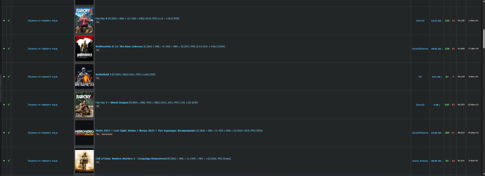
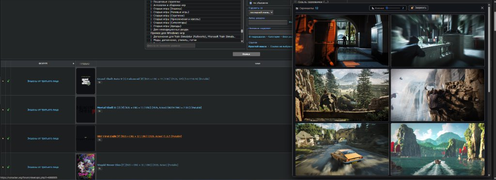
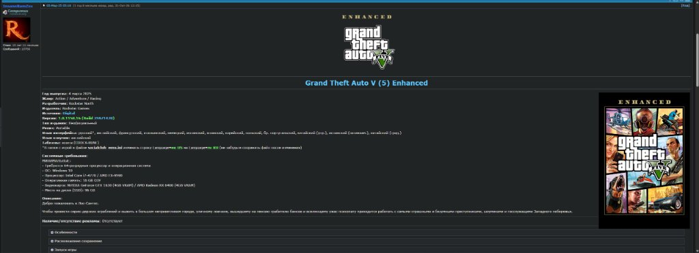
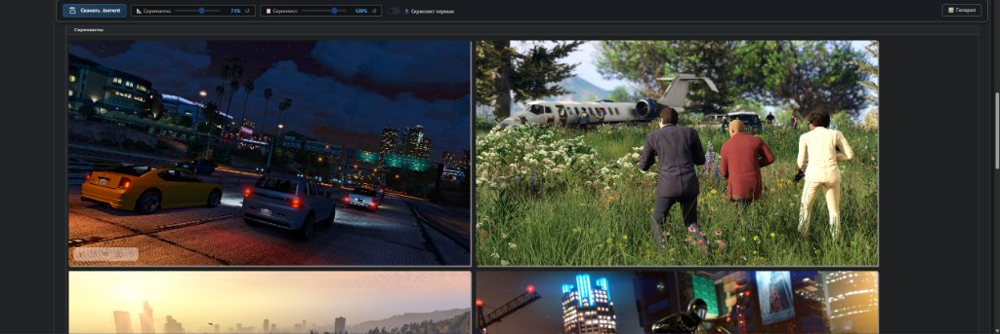
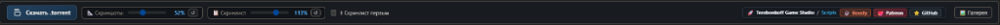

# 🧲 RuTracker: Enhanced Suite by TGS

> **Мощный комплекс для RuTracker.**  
> Встроенные обложки и кадры прямо в результатах поиска, выезжающая справа интерактивная панель скриншотов при наведении, мгновенная кнопка скачивания `.torrent`, полноразмерная галерея без перехода на внешние рекламные хостинги и полноэкранный Lightbox.

---

## ⚡ Быстрая установка в 1 клик

| Источник | Прямая ссылка |
|---|---|
| **🚀 Установка с GitHub (версия 5.22)** | [**👉 Нажмите для установки с GitHub**](https://raw.githubusercontent.com/Terebonkoff/TGS-UserScripts/main/RuTracker_Complete_Suite.user.js) |
| **🦊 Зеркало на Greasy Fork** | [**👉 Установить с Greasy Fork**](https://greasyfork.org/ru/scripts/605546-rutracker-enhanced-suite-by-tgs) |
| **☕ Поддержать автора на Boosty (Карты / PayPal)** | [**Страница Terebonkoff на Boosty**](https://boosty.to/terebonkoff?utm_source=userscript_rutracker&utm_medium=tgs_suite) |
| **💖 Поддержать студию на Patreon** | [**Patreon Creator Page**](https://www.patreon.com/c/terebonkoff/about?utm_source=userscript_rutracker&utm_medium=tgs_suite) |
| **⭐ Официальный репозиторий GitHub** | [**Terebonkoff/TGS-UserScripts**](https://github.com/Terebonkoff/TGS-UserScripts) |

---

## 📸 Визуальная презентация возможностей

### 1. 🖼️ Обложки и превью в списке раздач
Больше не нужно открывать десятки вкладок, чтобы понять, какая игра, фильм или релиз перед вами. Каждая строчка в выдаче дополняется аккуратной обложкой и кадрами:
- **Мгновенный визуальный ориентир:** постеры игр и обложки релизов отображаются прямо в таблице раздач.
- **Прямая кнопка «Скачать .torrent»:** загрузка торрент-файла в 1 клик без перехода на страницу раздачи.

  

---

### 2. 👁️ Правая всплывающая панель (Right-Dock) при наведении
Хотите оценить скриншоты игры или фильма, не покидая список поиска?
- **Просто наведите курсор на строку раздачи:** справа мгновенно появляется стильная панель с полной лентой скриншотов в высоком разрешении.
- **Интерактивная настройка:** регулятор количества колонок (от 1 до 4) и кнопка `📌 Закрепить` для комфортного изучения кадров.

  

---

### 3. 🎯 Чистая тема раздачи с аккуратным оформлением
Внутри темы раздачи всё организовано строго и понятно:
- Постер релиза, структурированные системные требования и описание без визуального мусора.

  

---

### 4. 🛠️ Встроенная галерея и единый тулбар управления
Все скриншоты раздачи автоматически собираются в чистую интерактивную галерею прямо на странице темы:
- **Удобный тулбар над кадрами:** кнопка «Скачать .torrent» с размером файла, слайдер масштаба скриншотов, слайдер скринлистов и кнопка полноэкранного режима `🖼️ Галерея`.
- **Без переходов на сторонние хостинги:** скрипт подгружает оригиналы изображений (FastPic, ImageBan, IBB и др.) без рекламы, капч и редиректов.
- **Интеграция поддержки TGS:** ссылки поддержки автора (Boosty, Patreon, GitHub) органично встроены прямо в строку инструментов.

  

  

---

### 5. 🧹 Зачистка баннеров и удобный интерфейс таблицы
- **Удаление раздражающих объявлений:** скрыты всплывающие блоки и баннеры донатов.
- **Компактная колонка автора:** ширина колонки уменьшена до ~3 см, освобождая максимум места для названия и постеров.
- **Ресайзер ширины колонок:** удобная регулировка границы между разделами форума для идеальной подгонки под ваш монитор.

---

## 🛠️ Установка и автоматическое обновление

1. Установите менеджер пользовательских скриптов:
   - [**Violentmonkey**](https://violentmonkey.github.io/) (рекомендуется) или [**Tampermonkey**](https://www.tampermonkey.net/).
2. Откройте прямую ссылку: [**RuTracker_Complete_Suite.user.js**](https://raw.githubusercontent.com/Terebonkoff/TGS-UserScripts/main/RuTracker_Complete_Suite.user.js).
3. Нажмите кнопку **«Подтвердить установку»** (или «Обновить»).
4. Скрипт автоматически обновляется при выходе новых версий из репозитория GitHub.

---

## 💖 Поддержка проекта

Разработка и поддержка осуществляются **Terebonkoff Game Studio**. Если расширение делает использование трекера удобнее:

  
  &nbsp;&nbsp;&nbsp;&nbsp;
  

| Способ | Возможности | Ссылка |
|---|---|---|
| ☕ **Boosty** | Банковские карты (РФ и весь мир), СБП, PayPal, Криптовалюта | [**👉 Страница Boosty**](https://boosty.to/terebonkoff?utm_source=userscript_rutracker&utm_medium=tgs_suite) |
| 💖 **Patreon** | Ежемесячная подписка, поддержка разработки и доступ к эксклюзивным материалам | [**👉 Страница Patreon**](https://www.patreon.com/c/terebonkoff/about?utm_source=userscript_rutracker&utm_medium=tgs_suite) |
