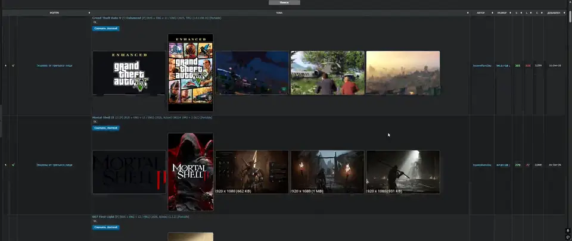
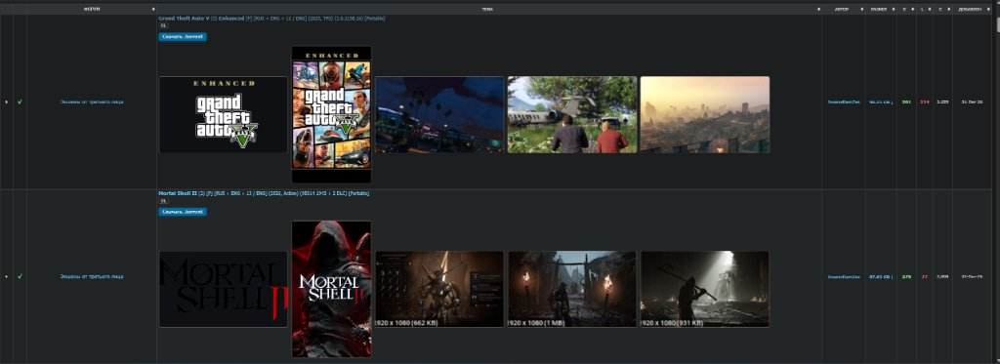

# 🧲 RuTracker: Enhanced Suite by TGS

> **The ultimate visual and workflow enhancement suite for RuTracker.**  
> Know exactly what game, software, or movie you are looking at before even opening the topic! Features inline cover and screenshot previews directly in search lists, an instant 1-click `.torrent` download button, a hover-activated Right-Dock screenshot drawer, a unified toolbar inside topics, and a full-screen Lightbox without ads or external host compression.

---

## ⚡ 1-Click Fast Installation

| Source | Direct Link |
|---|---|
| **🚀 Install from GitHub (v5.28)** | [**👉 Click to Install from GitHub**](https://raw.githubusercontent.com/Terebonkoff/TGS-UserScripts/main/RuTracker_Complete_Suite.user.js) |
| **🦊 Greasy Fork Mirror** | [**👉 Install from Greasy Fork**](https://greasyfork.org/en/scripts/605546-rutracker-enhanced-suite-by-tgs) |
| **☕ Support on Boosty (Cards / PayPal / Crypto)** | [**Terebonkoff Boosty Page**](https://boosty.to/terebonkoff?utm_source=userscript_rutracker&utm_medium=tgs_suite) |
| **💖 Support Studio on Patreon** | [**Patreon Creator Page**](https://www.patreon.com/c/terebonkoff/about?utm_source=userscript_rutracker&utm_medium=tgs_suite) |
| **⭐ Official GitHub Repository** | [**Terebonkoff/TGS-UserScripts**](https://github.com/Terebonkoff/TGS-UserScripts) |

---

## 📸 Feature Showcase & Screenshots

### 🎬 Live Script Demonstration in Action

  

> 💡 *Click the animation above or the link below to watch the full demonstration (52s) in GitHub's built-in player:*  
> [**▶️ Watch Full Video on GitHub (MP4, 1080p, 52s)**](https://github.com/Terebonkoff/TGS-UserScripts/blob/main/assets/videos/rutracker_presentation.mp4)

---

### 1. 🖼️ Inline Previews in Torrent Lists — Instant Visual Recognition
No more blindly guessing titles or opening dozens of redundant browser tabs to see what a release looks like:
- **Instant Visual Recognition:** Main poster/cover art and screenshots appear directly inside the topic row.
- **Direct «Download .torrent» Button:** Download the `.torrent` file in 1 click straight from search results without entering the thread!
- **Maximized Workspace:** The Forum column is narrowed (2x more compact), giving the Topic column generous space for clean, expansive screenshots.
- **Smart Filtering:** Clutter icons (magnets, close buttons, action tags) are 100% filtered out and never pollute previews.

  

---

### 2. 👁️ Right-Dock Hover Drawer — Full Gallery on Hover
Want to inspect all screenshots in a release without ever leaving the torrent listing?
- **Hover Over Topic Title:** A floating drawer smoothly slides out from the right with the complete high-resolution screenshot gallery.
- **Smooth Mouse-Wheel Scrolling:** Scroll through 10, 30, or 80+ screenshots effortlessly to check gameplay, UI, or video quality.
- **Column Slider & Pin Button:** Customize density from 1 to 4 columns and lock the panel with `📌 Pin` for comfortable browsing.
- **Isolated Trigger:** Only activates strictly when hovering over the title, preventing accidental popups across other columns.

  

---

### 3. 🛠️ Clean Topic View — Unified Toolbar & Direct HD Images
Inside individual topics, enjoy a completely decluttered, organized command center:
- **Unified Toolbar Above Screenshots:** «Download .torrent» button displaying exact file size, image zoom slider, screenlist slider, and full-screen gallery toggle.
- **Seamless TGS Support Integration:** Direct links to support the studio (Boosty, Patreon, GitHub) are natively built into the toolbar.
- **No Third-Party Host Redirects:** Direct uncompressed images (FastPic, ImageBan, IBB, etc.) load smoothly without ads, captchas, or popups.

  

---

### 4. 🎬 Fullscreen Cinematic Lightbox
Clicking any screenshot opens an immersive, distraction-free viewing experience:
- **Effortless Navigation:** Cycle with keyboard arrow keys (`←` / `→`) or mouse wheel.
- **Lossless Zoom:** View intricate game textures, interfaces, and video frames in pixel-perfect native quality.
- **Instant Escape:** Press `Esc` to smoothly return to reading the topic.

---

### 5. 🧹 Ad & Banner Cleanup with Flexible Table Layout
- **Compact Author Column:** Narrowed to ~3 cm, preserving valuable horizontal width for titles and screenshots.
- **Interactive Forum Column Resizer:** Drag the column border to perfectly fit your monitor resolution (double-click resets to 110px).
- **Distraction-Free:** Eliminates promotional banners and donation blocks.

---

## 🛠️ Installation & Automatic Updates

1. Install a userscript manager in your browser:
   - [**Violentmonkey**](https://violentmonkey.github.io/) (strongly recommended) or [**Tampermonkey**](https://www.tampermonkey.net/).
2. Open the direct script link: [**RuTracker_Complete_Suite.user.js**](https://raw.githubusercontent.com/Terebonkoff/TGS-UserScripts/main/RuTracker_Complete_Suite.user.js).
3. Click **«Confirm Installation»** (or «Update»).
4. The script is configured for automatic background updates directly from the official GitHub repository.

---

## 💖 Support the Project & Ongoing Development

All scripts are developed and maintained for free by **Terebonkoff Game Studio**.  
If this suite makes your RuTracker experience fast, modern, and enjoyable:

  
  &nbsp;&nbsp;&nbsp;&nbsp;
  

| Platform | Best For | Link |
|---|---|---|
| ☕ **Boosty** | Bank cards (RU & Worldwide), PayPal, Crypto & quick 1-click tips | [**👉 Support via Boosty**](https://boosty.to/terebonkoff?utm_source=userscript_rutracker&utm_medium=tgs_suite) |
| 💖 **Patreon** | Monthly backers, dev updates & exclusive community rewards | [**👉 Support via Patreon**](https://www.patreon.com/c/terebonkoff/about?utm_source=userscript_rutracker&utm_medium=tgs_suite) |
